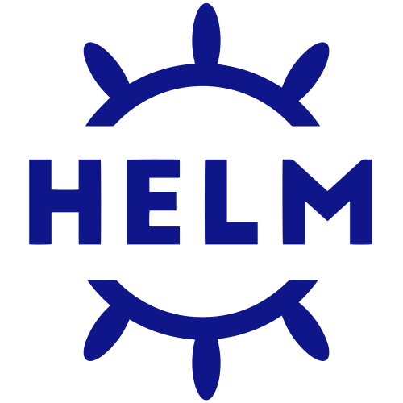

# Install Lolly Work on Kubernetes

This page is for a platform team adding Lolly Work to a Kubernetes cluster. You can
try it in one command, then install it for production with your own PostgreSQL,
identity provider and recoverable asset storage. The chart targets any conformant
cluster and is exercised on RKE2 and K3s.

::: logos
  
:::

SLES or openSUSE Leap, K3s or RKE2 with Rancher, SUSE BCI images and Application
Collection dependencies are supported options. So are an existing cluster, an external
database and another qualified container image. No particular cloud API or Application
Collection subscription is required.

**What you'll do**, in four steps:

::: steps
- <!--i:eti-flask--> **[Evaluate](#evaluate-on-a-cluster)** One install from the published chart: an in-memory store, sample people and the demo pack.
- <!--i:eti-folder-move--> **[Move to production](#move-from-evaluation-to-production)** A separate release from fresh, reviewed values. Nothing is copied over.
- <!--i:eti-package--> **[Install](#install-for-production)** Your PostgreSQL, identity provider, Secrets and a pinned image digest.
- <!--i:eti-badge-check--> **[Check](#check-the-installation)** Pods, the migration Job, health, readiness and real sign-in.
:::

<!--i:eti-checklist-->
## Before you start

- **Tools.** `kubectl` and **Helm 3**, pointed at the cluster you mean. Check with
  `kubectl cluster-info` and `helm version`. Select the exact kubeconfig, context and
  namespace for every command below; the examples assume you have.
- **The chart.** Lolly Work's Helm chart is published in a chart repository and listed on
  [Artifact Hub](https://artifacthub.io/packages/helm/lolly-work/lolly-work). The commands
  below add that repository and install chart %work{chart};
  [install from the chart repository or Rancher](#install-from-the-chart-repository-or-rancher)
  says how to check the chart first.
- **Images.** Multi-architecture images (amd64 and arm64) are published to
  `ghcr.io/lolly-tools/lolly-work-server` and `...-render-worker` for each reviewed
  `v*` release. The %work{version} images are public and need no registry credentials. Pin
  their digests for production; the
  [1.2.0 release notes](release-1-2-0.md#images-and-qualification) say where they are recorded.
- **One collaboration owner.** Lolly Work keeps one writable collaboration owner, so run
  one application replica. Separate render workers can scale once you have tested
  the workload. A redundant cluster does not route rooms or fail over the
  application by itself; [how a deployment fits together](deployment.md) explains
  why.
- **A support path.** Choose SLES with SUSE Rancher Prime for its commercial support,
  or openSUSE Leap with Rancher Community for a community-run stack. Check the
  version matrix, location and outside integrations against your own requirements.
  The [SUSE deployment runbook](../deploy/suse/README.md) covers cluster and storage
  choices.

::: details Build the image for your own registry or a disconnected mirror
To run your own registry or a disconnected mirror, build the image yourself only when
you need to:

```bash
docker build -f deploy/compose/Dockerfile -t <registry>/lolly-work-server:%work{version} .
docker push <registry>/lolly-work-server:%work{version}
```

The optional render worker needs a second image, built the same way from
`workers/render/Dockerfile`.
:::

<!--i:eti-flask-->
## Evaluate on a cluster

**One install**, with no PostgreSQL, no identity provider and no pack to mount. The
evaluation values ship inside the chart package, so pull the package first:

```bash
helm repo add lolly-work https://github.com/lolly-tools/lolly-work/releases/download/helm-index
helm repo update lolly-work
helm pull lolly-work/lolly-work --version %work{chart} --untar --untardir lolly-work-chart

# Name the release lolly-work: Helm prefixes every object with it, so the Service
# is then called lolly-work and the checks below work unchanged.
helm install lolly-work lolly-work/lolly-work --version %work{chart} \
  -f lolly-work-chart/lolly-work/values-eval.yaml \
  --set image.repository=ghcr.io/lolly-tools/lolly-work-server --set image.tag=%work{version}
```

What you get:

- an in-memory store (a restart is a factory reset)
- passwordless sample people behind the real sign-in gate
- the demo pack, served from inside the image
- working renders and the console at `/admin`

The pod requests 100m of CPU and 192 MiB of memory. Every choice in
`values-eval.yaml` carries a comment saying what it trades.

::: details Check the evaluation from a terminal
`values-eval.yaml` sets `instance.baseUrl` to `http://localhost:8787`, which is what
the port-forward gives you, so browser sign-in works too:

```bash
kubectl get pods -l app.kubernetes.io/name=lolly-work        # wait for Running
kubectl port-forward svc/lolly-work 8787:80 &                # Service port is 80, container 8787

curl -s http://localhost:8787/healthz
# {"ok":true,"name":"Lolly Work - evaluation","accessMode":"gated"}

C=$(curl -si 'http://localhost:8787/api/auth/dev?email=owner@eval.example' \
      | grep -i '^set-cookie: lw_session' | sed 's/^[Ss]et-[Cc]ookie: //' | cut -d';' -f1)

curl -s -H "Cookie: $C" http://localhost:8787/api/auth/session
# ..."groups":["owner"],"role":"owner"}}

curl -s -H "Cookie: $C" http://localhost:8787/api/v1/policy/tools
# a tools array, including qr-code   (the demo pack rides in the image)

curl -s -o out.svg -w '%{http_code} %{content_type}\n' -H "Cookie: $C" \
  'http://localhost:8787/render/qr-code.svg?url=https://example.com'
# 200 image/svg+xml
```
:::

Then open `http://localhost:8787/admin` and sign in as `owner@eval.example`. The
evaluation lists four sample people: `owner@eval.example` (group `owner`),
`admin@eval.example`, `brand@eval.example` and `marketer@eval.example`. The
addresses from the local install do **not** exist here, and anything outside the
list gets `403`.

::: details Reach the evaluation over the ingress instead of a port-forward
The evaluation ingress is plain HTTP with an empty host, so `curl` works against the
node or load-balancer address directly. Browser sign-in and links need
`instance.baseUrl` to match:

```bash
helm upgrade lolly-work lolly-work/lolly-work --version %work{chart} \
  -f lolly-work-chart/lolly-work/values-eval.yaml \
  --set image.repository=ghcr.io/lolly-tools/lolly-work-server --set image.tag=%work{version} \
  --set config.instance.baseUrl=http://<node-or-lb-ip>
```

::: warning Never point baseUrl at an https address without TLS
The `Secure` cookie flag comes from that address. A browser silently drops a `Secure` cookie sent over plain HTTP, so sign-in loops back to the gate for ever while `curl` still works.
:::
:::

<!--i:eti-folder-move-->
## Move from evaluation to production

::: warning The evaluation's data does not move
Adding `DATABASE_URL` only changes where future writes go. It does not copy the
memory store's projects, sessions or other records into PostgreSQL, and there is no
automatic memory-to-PostgreSQL migration.
:::

Do not use `values-eval.yaml` for a real team. Even with a database it keeps
passwordless sample people, known evaluation signing secrets and evaluation mode.
Prepare a separate production release from the chart defaults with fresh, reviewed
values, as below. An existing evaluation namespace or release needs a reviewed
transition, not a database-only upgrade with the evaluation values reused.

<!--i:eti-package-->
## Install for production

Start from the chart defaults and keep your changes in a reviewed environment file;
do not edit or merge `values-eval.yaml`. Existing K3s, RKE2 and Rancher platforms
keep their normal cluster lifecycle.


**1. Write `instance.json`**, following [Install Lolly Work, section 2](install.md#2-your-first-real-instance),
with:

- `deployment.mode: production`
- `dev.enabled: false`
- a real `idp.issuer`
- `instance.baseUrl` matching the ingress host

The pods refuse to start on a gated instance with neither an issuer nor development
sign-in.

**2. Create the Secret and install the chart:**

```bash
kubectl create secret generic lolly-work-secrets \
  --from-literal=DATABASE_URL=postgres://... \
  --from-literal=LW_SESSION_SECRET="$(openssl rand -hex 32)" \
  --from-literal=LW_LINK_SECRET="$(openssl rand -hex 32)"

helm install lolly-work lolly-work/lolly-work --version %work{chart} \
  -f /path/to/reviewed-production-values.yaml \
  --set image.repository=<registry>/lolly-work-server --set image.digest=sha256:<qualified-digest> \
  --set existingSecret=lolly-work-secrets \
  --set migrate.enabled=true \
  --set-file config=instance.json
```

Migrations run as a pre-install and pre-upgrade Job. The pack and the web app mount
as volumes. The chart also ships a `ServiceMonitor`, a `NetworkPolicy`, an ingress and
an optional Chromium render-worker tier; the values that matter are in
[how a deployment fits together](deployment.md#helm-values-to-know).

::: details What your reviewed environment file supplies
Your reviewed environment file supplies ingress and TLS, image-pull credentials and
the pack and web app delivery for a full workspace, or leaves them out for an instance
that serves only the console and API. The
[small SUSE profile](../deploy/helm/SMALL-SUSE.md) sets bounded resource defaults; it
is not a complete identity, database or content configuration. Provide credentials
through your platform's Secret provisioning, and keep Secret values out of
configuration files and release records.
:::

### Check the installation

This instance runs **your** `instance.json`, so its name, people and sign-in are the
ones you wrote:

```bash
kubectl get pods -l app.kubernetes.io/name=lolly-work        # wait for Running
kubectl logs job/lolly-work-migrate                          # the schema Job must have succeeded
kubectl port-forward svc/lolly-work 8787:80 &                # Service port is 80, container 8787
curl -s http://localhost:8787/healthz                        # your instance.name, accessMode gated
curl -s http://localhost:8787/readyz                         # actual store/deployment readiness
```

::: details Why the port-forward reads 8787:80
`8787:80` is not a typo. `service.port` is `80` and `targetPort` is the container's
`8787`, and `kubectl port-forward` reads the remote number as a **Service** port, so
`8787:8787` fails with `Service lolly-work does not have a service port 8787`.
:::

With development sign-in off there is no `/api/auth/dev`: sign in through your
identity provider at `https://<your-host>/admin`. The first owner arrives the single
sign-on way, from [the first-owner table](install.md#the-first-owner).

::: check Before you accept the instance
Test each of these, then restore an independent backup into a separate target and
repeat them:

- real HTTPS sign-in
- a viewer or editor invitation
- an uploaded asset on another device
- editing and reconnecting
- delegated agent permissions
- the exports you turn on

Backup coverage is in [keep Lolly Work running](operations.md#backup-and-restore).
:::

Later image-only releases use the
[guarded application update workflow](https://github.com/lolly-tools/lolly-work/blob/main/deploy/helm/APP-UPDATES.md);
database migrations, infrastructure and content changes stay separate operations.

<!--i:eti-download-->
## Install from the chart repository or Rancher

The commands on this page install from the published chart repository,
`https://github.com/lolly-tools/lolly-work/releases/download/helm-index`. Each chart
version is an immutable `chart-v*` release on GitHub with a Sigstore bundle and a source
record, and the chart is listed on
[Artifact Hub](https://artifacthub.io/packages/helm/lolly-work/lolly-work). Pick an exact
chart version and read what it holds:

```bash
helm repo add lolly-work https://github.com/lolly-tools/lolly-work/releases/download/helm-index
helm repo update lolly-work
helm search repo lolly-work/lolly-work --versions
helm show chart lolly-work/lolly-work --version %work{chart}
```

Check the chart's Sigstore bundle and source record, as
[official installation routes](official-installations.md#release-verification)
describes, before you apply the chart. To install from a reviewed source checkout
instead, use its `deploy/helm` directory in place of
`lolly-work/lolly-work --version %work{chart}` and keep your reviewed values,
configuration and Secret references. Mirrors are covered in
[official installation routes](official-installations.md).

In Rancher, add the same address under **Apps > Repositories**, then choose Lolly
Work and the reviewed version. The form collects connection settings; review the
full YAML for TLS, PostgreSQL, identity admission, owner mapping and the pack and web
app mounts. Adding this repository does not add Lolly to Rancher's built-in catalogue.

<!--lb:suse opensuse rancher k3s-->

## Prepare new SLES or openSUSE Leap hosts

On an existing Rancher-managed K3s or RKE2 cluster, keep your cluster lifecycle and
install the chart as above with existing Secrets. For a **new** host, a readiness
check comes first. It only checks the host and never installs a runtime. From a
reviewed source checkout on that host, save its result privately:

```sh
umask 077
sudo python3 -I deploy/suse/host-readiness.py \
  --profile k3s --expect-host lolly-rehearsal > /private/host-readiness.json
```

The [Ansible adapter](https://github.com/lolly-tools/lolly-work/tree/main/deploy/ansible)
and [Salt state](https://github.com/lolly-tools/lolly-work/tree/main/deploy/salt) run
the same check through your existing fleet tooling.

After that check:

- **K3s.** The pinned K3s operator path stages and qualifies a new UpCloud or Evroc
  host. It does not adopt an existing instance.
- **RKE2.** Install the host through your platform team's reviewed Rancher process or
  the official RKE2 process.
- **Then the chart.** The Lolly Work chart is the same on both.

The [platform-team workflow](https://github.com/lolly-tools/lolly-work/blob/main/deploy/suse/PLATFORM-TEAMS.md)
walks through provider and network review, the pinned K3s install, Helm values review
and real collaboration and restore acceptance. Its
[support table](https://github.com/lolly-tools/lolly-work/blob/main/deploy/suse/PLATFORM-TEAMS.md#support-and-remaining-qualification)
separates implemented automation, actual qualification and reference-only steps.

<!--i:eti-globe-->
## Cloud and on-premises choices

The Lolly Work repository has tested OpenTofu and Terraform foundations for
[UpCloud and Evroc](cloud-deployment.md). On-premises hardware, OVHcloud, Hetzner and
other European or global providers can supply the same Kubernetes or VM interfaces.
Each still needs its own qualified host image, network, storage, quotas and restore
evidence: a shared interface does not mean that provider has been tested.

A few boundaries hold on every target:

- Run the public web app, MCP and CA services in separate namespaces, with separate
  credentials, from the private Lolly Work instance.
- Lolly Work uses PostgreSQL for live collaboration, jobs and, optionally, uploaded asset
  bytes. Application Collection PostgreSQL is an optional, separately managed
  dependency. Keep Redis out of Lolly Work's PostgreSQL job path; Redis for public admission
  is a separate choice for the public services.
- K3s and RKE2 bring their own containerd and need no second Podman runtime. Rootless
  Podman image builds are documented. For a small machine without Kubernetes, the
  [Lolly appliance](aws-compatible.md#lolly-appliance-preview) has a podman profile:
  Lolly Work, its PostgreSQL and Caddy as Podman containers defined by Quadlet units.
  The appliance is a preview, and no appliance image is published.

::: details Image builds, WebAssembly, admission policy and alerts
Release developers who build images with SUSE BCI and Podman should read the
[platform-team builds section](https://github.com/lolly-tools/lolly-work/blob/main/deploy/suse/PLATFORM-TEAMS.md#developers-build-and-release-with-suse-images)
and the [application update guide](https://github.com/lolly-tools/lolly-work/blob/main/deploy/helm/APP-UPDATES.md).
Optional WebAssembly policy and worker tracks are in
[WebAssembly and Kubewarden choices](wasm-deployment.md); neither adds a requirement
to a private install. A cluster that enforces admission policy with Kubewarden can
apply the [policy set for Lolly Work's pods](admission-policy.md), and a cluster with
Prometheus can install the [suggested alerts and dashboard](metrics.md).
:::
