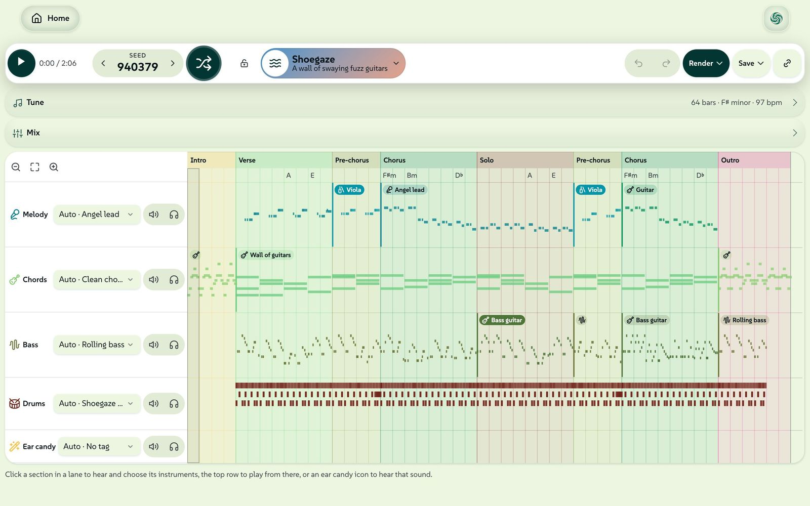
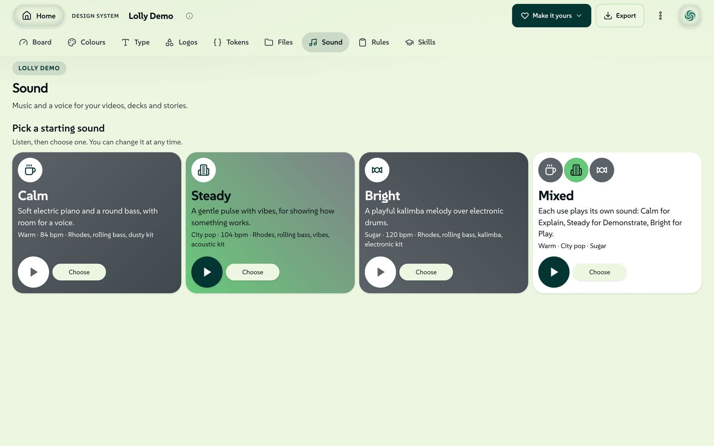
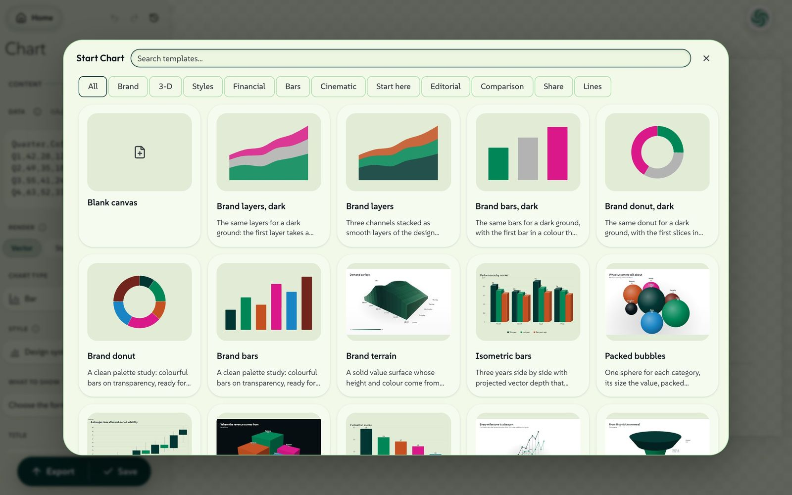
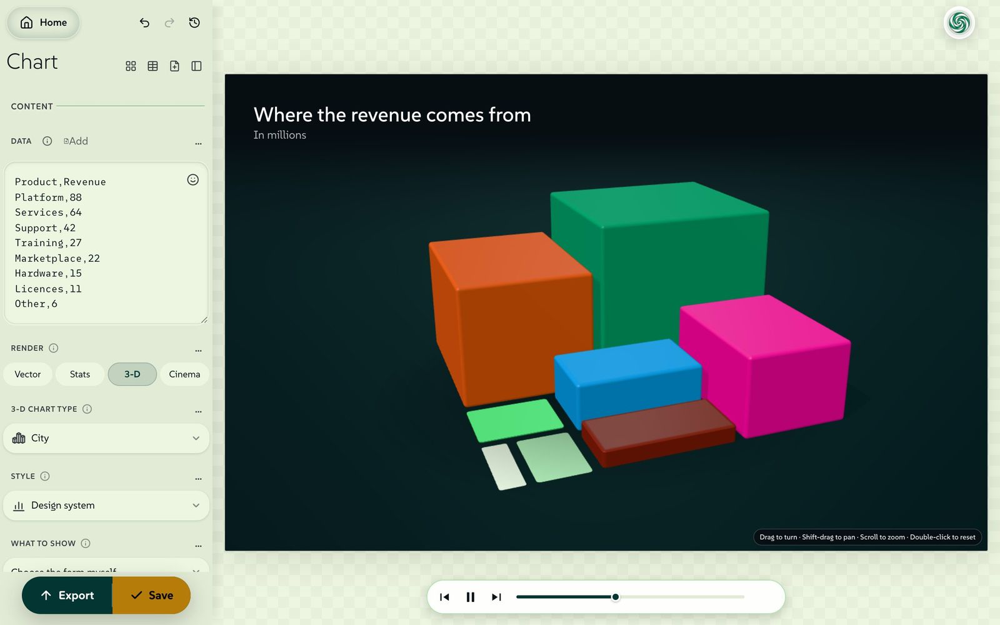
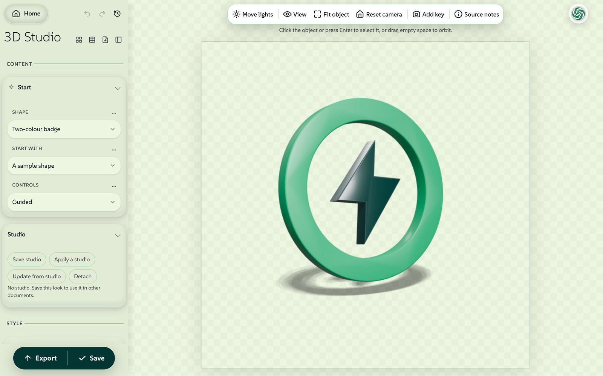
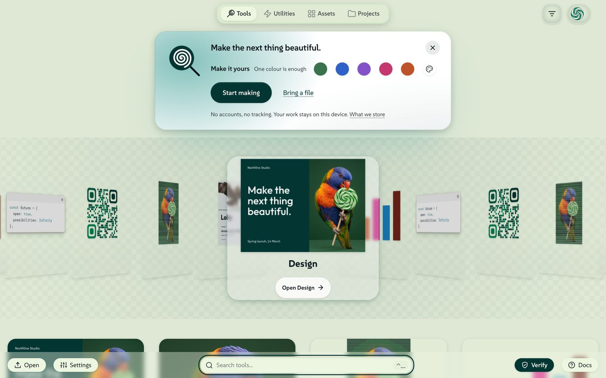
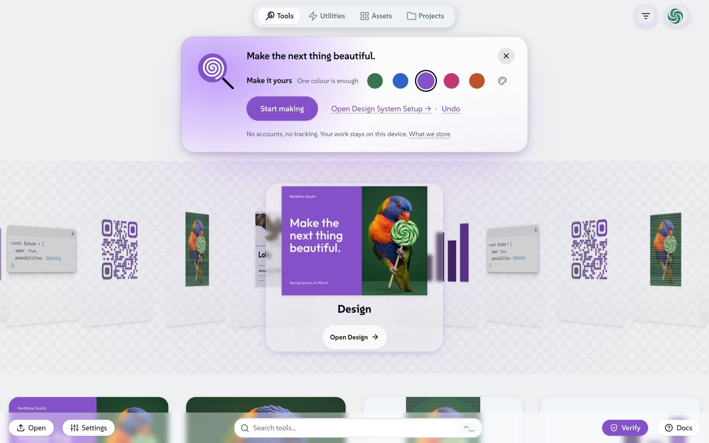
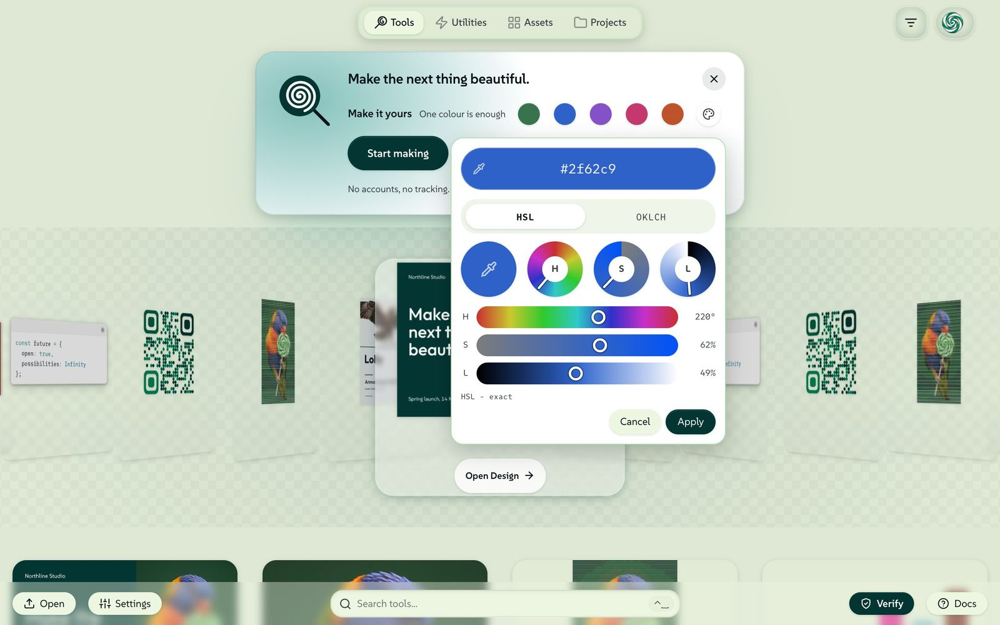

# Lolly 1.2.1: the Singing one

Nov 18, 2026 · @Andy Fitz

These notes cover 107 pull requests and no direct commits, merged to `main` after [v1.2.0](https://github.com/lolly-tools/lolly/releases/tag/v1.2.0) up to `ad3976ca3` (18 November 2026), and the changes in the release pull request itself. The engine moves from 1.343.0 to 1.348.0, and the tool-author core stays at 1.8.0.

Lolly 1.2.1 is the Singing one, for two reasons. The first is speed: Lolly sings when nothing stalls, jumps or flashes, and this release takes out pauses you could see and feel. Long music renders take seconds instead of minutes, a saved tune plays as soon as you press play, the welcome card no longer moves the page as the gallery loads, leaving a tool no longer flashes bare markup, and sections fold smoothly in Safari, Firefox and the apps. The second is music. The music generator and the Neurospicy player gain 29 genres, instruments modelled on real ones and measured against recordings, vocal chops in four voices, record scratches and a Lolly producer's tag. Everything you make there is free for any use under CC BY 4.0, with a credit.

## Highlights

- **Smoother and quicker.** Long tracks render in seconds, a saved tune plays when you press play, the welcome card arrives with the gallery, tools leave without a flash, and sections fold smoothly in Safari, Firefox and the apps.
- **29 new genres** in the music generator and the Neurospicy player, from Sherbert's future bass and Lofi house to Persian, Koto, Kora, Ska, Grunge, Noosacore, Arnhem Land and Trailer.
- **Instruments built like the real ones.** Drums, guitars, brass, reeds and strings are modelled on how each instrument makes its sound, and measured against recordings of real instruments. Nothing is sampled.
- **Vocal chops in four voices**, record scratches, shouts and a Lolly producer's tag.
- **A music generator that is easier to use:** a genre picker with search and favourites, an instrument popup that plays this tune's part on each instrument, undo and redo, and **Render** for a full-quality file.
- **Music you can use anywhere, with a credit.** What you make comes under CC BY 4.0, and every file states the licence and carries Content Credentials that record music made by an algorithm, with no AI.
- **A Sound room** in Design System Setup gives a design system a sound of its own, chosen by listening.
- **Make it yours with one colour.** The welcome card offers five colours and Lolly's own colour picker. One press makes a design system from that colour and the gallery recolours in place, with Undo.
- **Chart in 3-D that you can turn**, with 13 kinds of scene, nine cinematic forms and a picture for every chart type and style.
- **Tools that wear your design system further.** Link Card, Stationery, Wayfinding, Logo Wall, Doc Studio and Booklet take brand treatments, with layouts that follow the content.
- **A shorter list of tools.** Eight business document tools leave the gallery on lolly.tools and in Lolly Starter. Their links and saved projects still open.
- **3D Studio on the canvas.** Select an object and move, turn, lift or scale it with handles, and move the camera with a drag, a pinch or the wheel.
- **Icon colours and photo washes from your colourways.**
- **Strip Hidden Data takes audio.**
- **Share a tune or a moment** from the Neurospicy player, which shows its progress bar again.

## Smoother and quicker

- **Long tracks render in seconds.** Rendering a long track took far longer than the track itself: in a test on a busy machine, 64 bars of Sugar were 7.5% done after 57 seconds, on course for about 13 minutes. The same track now renders in about 28 seconds. This covers **Render** in the music generator, saving a tune from the Neurospicy player and a video's music bed.
- **A saved tune plays when you press play.** In Assets, a saved tune now plays live, the way the Neurospicy player plays one, with the level meter and the visualiser moving. Before, opening a saved tune started two full renders, and pressing play before they finished did nothing: for a full-length track that could be a minute and a half.
- **The music generator draws a track once.** While a track plays, the generator copies the drawn track to the screen each frame, where it used to draw every note again sixty times a second.
- **Live playing keeps up.** **Play** works a track out live at the detail your device can keep up with. **Render** works the whole track out first at full quality, with denser cymbals and finer guitar amps.
- **The welcome card arrives with the gallery.** On a first visit the card used to appear first in the empty loading view, push the loading spinner down and then jump into place, and its headline changed typeface when the display font arrived. The card now appears in the gallery's first paint, in a typeface loaded before then, and moves nothing else on the page, on a first visit or a later one.
- **No flash when you leave a tool.** Leaving a tool showed its markup without styles for up to half a second; Claim's icon, for one, filled the canvas as the view faded. A tool now keeps its styles until its markup has left the screen. Counted frame by frame in a browser, leaving QR Code for Assets went from 99 frames of bare markup to none.
- **Sections fold smoothly in Safari, Firefox and the apps.** Folding sections, such as the tool sidebar's sections, the Settings cards, Design's inspector and the music generator's Tune and Mix, opened and closed smoothly only in Chromium browsers such as Chrome and Edge, and snapped everywhere else. They now fold the same way in Safari, in Firefox, on iPhone and iPad and in the desktop app. Reduce motion still opens and closes them at once.
- **Covers keep their picture while they redraw.** After you change the design system or the theme, each gallery cover keeps its last picture until the new one is drawn, in the grid and in the featured band, so the gallery recolours tile by tile instead of dropping to placeholders. A held cover comes off if the new drawing fails.

## New genres

The music generator and the Neurospicy player's stations gain 29 genres, for 55 beside the original Lolly Sings and the three Lofi moods. Every sound is synthesised on your device.

- **Sherbert:** future bass with an old games console inside. A half-time groove at 136 to 150 bpm, wide chords that bend and wobble, a lead of chopped vowels or a console pulse, console sparkles, game sounds and shouts.
- **From around the world:** Persian (a tar, a santur and a ney or a kamancheh, in a dastgah), Guzheng (the zither with an erhu, a dizi or a pipa), Koto (koto, shamisen, shakuhachi and taiko), Kora (the kora over a balafon, djembe and dunun), Afrobeat (horns, organ stabs, a chopping guitar and a talking drum), Amapiano (a log-drum bass under jazzy piano), Salsa, Mandopop (ballads, R&B and soft rock) and C-Pop (dance-pop, trap-pop and future bass with traditional hooks). The erhu and the dizi are fitted to recordings.
- **From Australia:** Noosacore (bass and effects with surf licks, a light didgeridoo, waves, she-oaks, magpies, whipbirds and rainbow lorikeets) and Arnhem Land (the region's band music today, with the Yidaki and the bilma). Straya's magpies and kookaburra are now fitted to field recordings, and the Didgeridoo and the Yidaki are two instruments that layer.
- **Bands:** Ska (an offbeat skank, a walking bass and horns), Punk, Grunge (a quiet verse and a loud chorus), Stoner rock, Shoegaze (a wall of guitars), Surf rock, Yacht rock and Oompa (a Bavarian brass band).
- **Club and bass:** Lofi house (a loud deep-house bass under a quiet lead), Funky house, UK garage, Private school piano (amapiano at its most mellow), Breakbeat, Jungle, R&B, Botanica (synthesised nature sounds, granular pads and glitch) and Trailer (a film-trailer cue of hits with an impact, a braam and a sub drop).
- **Heavier Metal.** Palm-muted chugs through a high-gain amp model, double-tracked and panned apart.
- **Layered basses.** In Dubstep, Brostep, D&B and Electro, extra bass parts play over the main bass and build through each track: a harmony bass, a travelling line and short percussive knocks. The bass talks at the end of each drop phrase in Dubstep, Brostep and D&B.
- **Chopped breaks.** Breakbeat, Jungle and some D&B, Hip hop and Trip hop tunes play a drummer's break recorded once per tune through a model of an old sampler, cut into slices and played in a new order.
- **Arranged like records.** Builds sweep into the drop, the room grows in intros and breakdowns and tightens in a drop, and an echo catches the last note of a phrase. Lo-fi and jazz can crackle like a record.
- **Tracks end on their outro.** A track's last tune is cut at the end of a phrase and finished with its own outro and fade, never between a build and its drop.

## Instruments

Every instrument is synthesised. Where a model was measured against recordings of real instruments, the recordings were used for measurement only, and none is in Lolly.

- **Drums.** Every tune plays its own kit. The acoustic kit is modelled on recorded one-shots: a kick that stops as a real one does, a snare whose wires buzz as long as the head moves, a ride with its bell, and new strokes for the cross-stick, the hat's foot and the press roll. Toms are struck by a stick and ring on two heads, measured against recorded toms. Cymbals ring with a few hundred partials, measured band by band against recorded cymbals, and the jazz kit has a dark, washy ride of its own.
- **A drummer, not a grid.** Each hit falls a few milliseconds off the beat and varies in strength, each style has its own pocket, and a drummer may ride the bell through a chorus or end a jazz chorus on a press roll.
- **Guitars.** Plucked strings are modelled as strings. A new single-coil electric guitar, measured from a recorded instrument, plays the skank in Ska, the chop in Reggae, the chicken scratch and licks in Funk, and picks held chords in the quiet parts of City pop, Funk and Rock. Rhythm parts are strummed on real chord shapes, and lead notes bend and slide.
- **Brass and reeds.** Trumpets and trombones are blown through lips and a bore, and a sax and a clarinet through a reed, so a note brightens as it gets louder. Ska, Afrobeat, Soul, Funk and Swing play their horn lines as a section.
- **Strings, keys and more.** A bowed fiddle, viola, cello, double bass and string section, a Rhodes, a combo organ, a house organ, a grand piano, a steel-string acoustic, a flute with breath, Latin percussion and a spring reverb.
- **Vocal chops in four voices.** Chops are sung by a woman's, a man's, a baritone's and a child's voice measured from real singing, alone or in groups, and each genre casts its own.
- **Record scratches.** A turntable model scratches the tune's own sounds, never a record. The **Turntable** plays a melody as scratches, and Hip hop, Breakbeat and Jungle place scratches of their own.
- **Shouts and a tag.** The band shouts "pick it up", "let's go" and "go" where a band or an MC would, and about six tunes in ten carry a Lolly producer's tag, delivered in one of ten ways, from spoken and sung to whispered, shouted or robot.
- **The lead plays at its place in the band.** Each genre sets how loud its lead plays against the band, so a lead no longer drowns the rest or gets buried.
- **The soft lead is retired.** The flute takes its place, and a link or saved tune that chose the soft lead plays the flute.
- **Behaviour change: some tunes from 1.2.0 sound different.** A genre and a seed still compose the same tune on every device, but this release changes some tunes. Upgraded instruments change how many tunes sound, every vocal chop is sung in a new voice, and some tunes that drew the soft lead now play another lead. Some genres gained parts: the bass in Dubstep, Brostep, D&B, Electro, Nu-disco and some Sugar tunes, D&B's drums, chopped breaks in D&B, Hip hop and Trip hop, scratches in Hip hop and a few other genres, and the electric guitar in Reggae, Funk, City pop and Rock. The Generated music guide lists each change.

## The music generator



- **Choose a genre from cards.** The genre button shows the genre playing, with its icon, its name and a line about what you hear, in the genre's own colours. It opens every genre as a card in six groups, Chill, Rock & Roots, Soul & Groove, Club, Bass & Synth and World, with **Favourites** and **Recent** rows and a search field. **Manage** stars a genre, which shuffle then draws more often, or hides one, which shuffle never draws.
- **Shuffle and the padlock.** The round shuffle button draws a new genre, seed and sound. Hold Shift to keep the genre, the seed and the key and change only the sound. The padlock beside the button keeps shuffle in the genre you chose, and a closed padlock travels in a link as `lock=genre`.
- **Five tracks with plain names:** Melody, Chords, Bass, Drums and Ear candy. A track's head reads **Auto** and the instrument's name when the composer chose the instrument.
- **An instrument popup.** Click a section in a lane, or a track's head, to see the instruments for that part. Each card plays two bars of this tune's part on that instrument. **Use in every Drop** (named for the section you chose), **Use everywhere** and **Auto** decide where the choice applies. Star an instrument to hear it more often in shuffles, or block one to keep it out, and **Your instruments** lists both. For the drums, the popup chooses the kit, which changes the sound and never the notes.
- **Tune and Mix.** **Tune** sets the length, the key (up to six semitones either way), the tempo and **Reset**. **Mix** sets each part's level, the room, the texture, the brightness and the drive on pill sliders, turns kinds of ear candy on or off (Voices, Console, Sparkles, Sweeps, Aussie birds and Waves) and chooses how a tune says "Lolly".
- **Ear candy moments** show as icons on their lane. While the track is stopped, press one to hear that moment on its own.
- **Undo and redo** cover every change in the studio, with Cmd or Ctrl+Z.
- **Render** works the track out at full quality, with a card that shows how far it has got and a Cancel button, then offers **Render and play**, **Download M4A** and **Download WAV**. A change to the track stops a render under way.
- **Save** offers **Save to assets**, which keeps the track as a tune of a few hundred bytes, and **Save to projects**, which reopens the generator as you left the track. A track no longer has to be rendered before you save.
- **The visualiser** shows a spectrum analyser in the colour of the section playing, with **Expand** and **Full screen**, where MilkDrop plays with its presets.
- **On a phone**, play, the seed, shuffle, **Render**, **Save** and the link are in a dock at the bottom, under a seek bar that snaps to the bars of the tune.
- **A first visit opens on a random track.** A link still opens the track it holds.

## The Neurospicy player and saved tunes

- **Share this tune or this moment.** The player's share button offers **This tune**, from the start, or **This moment**, from the bar you had reached, with the visualiser as you saw the music. Whoever opens the link hears the same tune on the gallery, Utilities or Assets, and your visualiser look applies for their visit only. A track you uploaded stays on your device, so the card offers no link for that track.
- **The progress bar is back.** Generated stations lost the bar in 1.2.0. A click, tap or drag now moves a generated tune to the nearest bar, the time row shows the bar and the part, and the arrow keys step one bar. A recorded track seeks by the second. On a phone the bar takes taps, which a native slider did not on iOS.
- **Simple icons.** Open in the music generator, Share this tune or moment, Save to library and Light visualiser are icons with tooltips.
- **Saved tracks play everywhere.** A track saved from the music generator plays in the player and in Assets, and works as an audiogram's sound or a video's music bed, looped to fill the video.
- **Saved tunes in Assets** play live, seek by bar, and list **Music generator** first under **Open with**, so you can carry on editing.

## Licence and Content Credentials for music

- **CC BY 4.0.** Music made in the music generator, the samples on the genre pages and the tunes the Neurospicy player's stations compose come under the Creative Commons Attribution 4.0 International licence: free for any use, including commercial use, with the credit "Music made with Lolly (https://lolly.tools), CC BY 4.0".
- **Every download states the licence**, in its copyright field, in an XMP packet and in its Content Credentials.
- **Content Credentials on every download.** Each M4A and WAV carries a signed record that the music generator made the track, procedurally and with no AI, with the genre and the seed. Its digital source type is algorithmic media, so a checker does not flag the track as AI, and the record carries no person's name. There is no switch to leave the record out; Strip Hidden Data removes the record from a copy.
- **Saved tunes record who made them.** A tune saved from the generator records the maker from your profile, the music generator as its source, the Lolly and engine versions, and a licence, CC BY 4.0 unless you change the licence in the tune's details. Tunes saved before this release keep what they had.
- **Tunes inside other files.** A saved tune used as a video's music bed, an audiogram's sound or a timeline clip is recorded as a source in that file's Content Credentials, with its licence. The maker's name goes in only while **Use my details** is on.
- **Lolly's catalog tunes.** New tunes in Lolly's catalogs are CC BY 4.0. The six already released stay CC0.

## A sound for your design system



- **The Sound room.** Design System Setup has a Sound room for choosing a design system's sound by listening. It opens on three starting sounds, Calm, Steady and Bright, each a card with a play button, and a fourth, Mixed, which gives each use a sound of its own: Calm for Explain, Steady for Demonstrate and Bright for Play. **Choose** applies a sound and **Save sound** keeps the sound with the design system.
- **Uses.** Explain, Demonstrate and Play to start with, or a use you add. Each use keeps its own tune and balance and plays as music alone or under a voice.
- **Edit in the music generator** opens a use's settings in the generator, and **Save to this use** brings them back. **Make a music project** opens a project that keeps the use and the version of the sound.
- **The detail is folded away:** a voice with its speed and balance, a sound signature kept as its own audio file, the brand's character and a recorded listening review.
- **The sound's notes stay private.** Share links carry the music settings only, and the notes stay out of share links and out of an audio file's public credentials. A design system without a sound works as before.

## Chart





- **A 3-D canvas you can turn.** In the editor, drag to turn the camera, Shift-drag or two fingers to pan, scroll or pinch to zoom, and double-click or press 0 to go back. The arrow keys turn and + and - zoom. The view is saved when you let go, as **Adjust view** in the sidebar, so the view travels in links, undo and saved work. Choosing another camera clears the adjustment.
- **Scenes framed to the artboard and lit from your colourway.** The camera fills the artboard's safe area clear of the title and legend, and the Hero pose picks the angle that suits a portrait or a landscape artboard. The stage takes its colours from the active colourway. New and reworked controls: Arrangement, Highlight, Camera, Lens, Framing, Stage (studio, floor with grid, floating, plinth or night) and Finish, which adds satin, metal, clay and glow.
- **Ten new kinds of 3-D chart** join Bars, Scatter and Surface: Donut or pie, Walls, Tiles, Unit blocks, Waterfall, City (a treemap of buildings), Rose, Funnel or pyramid, Bubbles and Spiral.
- **Five directed cinematic forms** join the four flights: Spotlight tour, Countdown, Pull-back reveal, Gate tunnel and Terrain flight. A video plays every beat, and a still is the closing wide shot.
- **Every type as a picture.** Chart type, statistical form, 3-D chart type, cinematic form and style each open as a panel of tiles under group headings, with a picture for each of the 80 options. On a phone the panel is a bottom sheet. The sidebar now follows the order you work in: data, render, type, style, what to show and title. A control the chosen type never reads is hidden. Links, saved charts and defaults are unchanged.
- **Exports match the screen.** SVG, PDF and the CLI draw the same 3-D scene as the browser, where the 3-D SVG used to be a separate isometric drawing. A still of a moving scene shows the finished pose; before, a reveal exported bars with no height.
- **A smaller, more colourful set of 43 templates.** Templates that drew in one colour whatever the palette, or repeated another, are gone. Radial share, Treemap, Sunburst, Stream and Marimekko are new, in the design system's colours, and the new 3-D types and cinematic forms bring 14 templates to start from.
- **Behaviour change: a 3-D chart paints its stage.** Its background is opaque until you tick **Transparent background**, which keeps only the shadows.
- Unit blocks no longer split whole counts into part blocks.

## Tools



- **A shorter list of tools.** Pricing, Week, Scorecard, Email, Brief, Sales Quote, Battlecards and Calendar are no longer offered in the gallery, search or menus on lolly.tools or in Lolly Starter, which now list 65 tools. A link to one of the eight still opens, and so does a saved project, a render URL and a request from an agent or the command line. The SUSE pack lists all eight, and they gain the brand treatments, layouts and motion below. A profile chooses this with a new `unlist` entry in `profiles.json`.
- **Brand treatments.** Link Card, Stationery, Wayfinding, Logo Wall, Doc Studio and Booklet start on a tint of your design system and offer lead-colour, ink and surface treatments, with text colours that read on each. Meeting Planner starts on a brand tint.
- **Layouts that follow the content.** Columns, reading lists, cards, tiles, split messages, agenda views and picture placement. Spacing responds to how much text there is, and the screen tools fit longer content to their canvas. Content that still cannot fit shows a message instead of overflowing.
- **Motion you can export.** Link Card fades and rises in reading order, exports GIF, MP4 and WebM, and plays back in portable HTML. Motion follows the design system's duration and curve tokens. A still export shows the finished pose, and Reduce motion calms the preview without changing an exported animation.
- **3D Studio 0.11.0: controls beside the picture.** The studio's controls now stand at screen size beside the picture, in the app's own look: a band at the top on a computer and one scrolling row above Export on a phone. Before, on a phone nine buttons covered almost half of a small picture. The picture holds still when you change mode.
- **3D Studio: the camera on the canvas.** A drag or the arrow keys orbit, all the way round, and a key turns the way a drag does. Two fingers, Shift-drag or a middle-button drag pan, and a pinch, the wheel, + or - zoom. A double-click or double-tap frames the object under the pointer, or everything, and 0 or Home resets the view. The View menu has Front, Side, Top and Three-quarter. Each gesture is one undo step.
- **3D Studio: handles on the object.** Click an object to select it and drag to move the object along the floor. A ring turns the object in 15-degree steps (Alt turns freely), a square on a stem lifts the object, and a square on the ring scales the object from 0.1 to 5 times, with the value shown while you drag. On a wide screen, Duplicate, Remove, Rest on the stage and Tilt stand under the selected object. With an object selected, the arrow keys nudge it, comma and full stop turn it, the brackets select the next or previous object, Delete removes the object and Escape clears the selection.
- **Flythrough and Booth open on a picture again.** With the template chooser open, the tool could stay blank until the first change.
- **Audiogram records its own sound.** **Record** in Audiogram now makes the take the tool's audio, and the picture redraws from the recording. An earlier take stays in your library, and a take recorded in Firefox is filed as Ogg.
- **Recording on a phone.** The rear camera's preview is no longer mirrored, the screen stays awake during a take, a voice note is saved under the name you typed, and Screen Capture says when the browser cannot capture the screen.
- **Drawing tools on a phone.** Design and Flow Chart kept Line, Pen, Pencil, Edit points, Auto-arrange and the grid switch on a rail a phone does not show. **Add** now offers Line, Pen and Pencil, **More** offers Edit points, Auto-arrange cards and Snap to grid, and **Done** returns to the pointer.
- **Zoom buttons that only zoom.** In Street Map and Meeting Planner a zoom button also opened the Theme or Projection picker. The buttons now show on touch screens and stay out of exports.
- **Smaller repairs.** Scan drops two switches that did nothing. Claim's drop area opens with Enter or Space, Annotate shows its handles on touch, and Palette Lab says when a copy failed. Compress and Convert Image use the design system's typeface. Screen Capture, Convert Font and Theme swap no longer send you to controls that are not there, Sign asks for the PDF before the signature, and decorative marks in Clean, Pages, Sign and Trim are hidden from assistive technology.

## Home and first visit







- **A welcome card that floats.** A first visit opens on a lit card over the top of the gallery instead of a full-width band. Close the card with its round button, Escape or a sideways swipe on a touch screen, and the gallery slides up into the space. The lorikeet is gone, so the lollipop is the one thing to look at.
- **Make it yours with one colour.** On a blank install, **Make it yours** in the welcome card is now five colours and a palette button. One press makes a design system from that colour, as Design System Setup does from a first colour, and the gallery recolours in place. The palette button opens Lolly's own colour picker, with HSL and OKLCH dials, never the browser's colour dialog. The card stays up with **Undo** and **Open Design System Setup**. On Lolly Demo the colours come above **Start making**, and one press makes a design system of your own, My design system, with Lolly Demo's typefaces and logo slots. If this device already holds a design system of yours, the card opens Design System Setup instead.
- **A quieter Open on Cover Flow.** The Open control on the centred cover uses the app's raised surface instead of white on black, says which tool it opens, such as **Open Design**, and appears once a cover has come to rest, or while the keyboard is on the control.
- **One kind of tile in the template chooser.** Every tile keeps the picture's place, so nothing moves when a preview arrives, and each description shows two lines, with the whole sentence in its tooltip.
- **One arrow for every expandable section.** Expandable sections across the app draw the same arrow, two fine lines that point along the line when closed and down when open, in place of the browser's triangle and typed marks. The Projects list draws its sort arrow the same way.
- **A shorter starter description.** The starter design system's description opens with two short sentences, and the token detail follows behind **Read the full note**.

## Everyday use

- **Icon colours and photo washes from your colourways.** In Assets, the icon colour and photo strips offer **Original**, then one choice for each of the design system's colourways, named as the colourway is, such as Spearmint, Morning, Spring, Beach, Afternoon and Midnight on Lolly Demo. Icons take a two-colour pairing and photos a gradient map. A design system with no colourways shows no strip, editing a colourway changes what is offered, and nothing you already made changes colour.
- **Clear all my data says what it could not clear.** If a step fails, a dialog lists what is still on the device and offers **Try again**, and **Restart Lolly** carries on as before. Before, a failed step reached only the log.
- **The Large text tip** says what Large text grows: type and icons by a fifth, and the top row and standard controls to hold them.
- **Canvases that hold controls are reachable.** A tool's canvas that holds controls, such as a map's zoom buttons or Design's boxes, is now a group for assistive technology instead of an image, so a screen reader can reach those controls. In a sweep of 75 Lolly Demo tools, 13 had controls hidden this way, and none do now. A canvas that is only a picture keeps the image role.
- **A pinch on a canvas zooms the canvas.** On a touch screen, a pinch that starts on a tool's canvas zooms the canvas and never the page.
- **A clearer progress bar.** The progress bar is twice as tall, with no outline, in two shades of the main colour.

## Privacy

- **Strip Hidden Data takes audio.** Strip Hidden Data 1.5.0 removes tags, Content Credentials and other hidden data from M4A and MP4, WAV, MP3, FLAC and Ogg Opus files and leaves the sound untouched. Each clean copy is read back and must hold identical audio, or the strip fails. Verify offers a cleaned copy of a WAV or MP4.
- **The Privacy Policy matches the app.** Usage counters travel in your own backups and Sync. Trash keeps items for 30 days unless you empty the Trash sooner. Clear all my data keeps a tab marker and does not end an organisation sign-in. The policy now lists more of what Lolly keeps on the device, such as profile details, your signing identity, shared links and recent downloads, and says that a remembered Drive connection keeps an email address. The policy also says that Lolly's apps send Lolly Work no usage events, and that a workspace keeps a log of sign-ins and activity and any brand pages published to the workspace.
- **The workspace privacy line.** With a workspace connected, the notice now says the rest stays in this browser unless you send it elsewhere. A font, Drive, Dropbox or Sync can take things off the device when you ask.

## For agents and automation

- **Chart by URL.** The skill reference and the agent skill cover the new 3-D chart types (`sct`), the cinematic forms (`cft`) and the adjusted view (`svw.*`).
- **Pickers stay selects.** An input the web app draws as a picker is a plain select in the CLI, the terminal app and MCP, with the same values.
- **`lolly inspect`** reports what a strip would remove from a WAV or MP4 file.
- **The MCP browser image builds again.** Its qualification probe expected the tool list from before `lolly_resolve_intent`, which held the image back in 1.2.0. The probe now expects that tool, and a test compares its list with the server's tools.

## For tool authors and contributors

- **Pictures in a select.** A `select` input can set `display: "picker"`: the web sidebar draws one button and a panel of option tiles, a bottom sheet on a phone. `options[].glyph` is SVG path data for a 24 by 24 box and `options[].group` a heading. A tool's translation file can translate a heading as `inputs.<id>.groups.<heading>`. Other shells keep a plain select.
- **A recording as an audio input.** A tool with an asset input called `audio` takes a take recorded in the tool as that input.
- **Gestures of your own.** An element marked `data-stage-gestures="own"` keeps the stage from panning or pinching under a press inside the element.
- **Versions.** The engine moves from 1.343.0 to 1.348.0: 1.344.0 adds colourway icon pairings and photo washes, 1.345.0 the audio stripper, 1.346.0 and 1.347.0 the music licence and credit, and 1.348.0 the picker. `@lolly-tools/core` stays at 1.8.0. Its manifest types and schema take the picker fields, `Profile` gains optional `music` preferences for the music generator, and `@lolly-tools/core/sonic-profile-v1` describes a design system's sound, with its schema.
- **Docs blocks.** Docs pages can use `::: steps`, `::: logos`, `::: note`, `::: warning` and `::: check` blocks and a two-tone section icon before a heading, and shell code blocks are highlighted.
- **Boot budget.** The web shell's boot JavaScript budget in `check:bundle` rises from 159 KB to 200 KB gzipped. The heavy libraries stay off the first paint, and the music code loads only when the music generator opens.

## Languages and guides

- Translations are still on hold. Text added since 7 November, such as the music generator's new controls, the Sound room, Chart's pickers and the welcome card's colours, is in English in the other languages until the next translation pass.
- New guides: the music generator, with a picture of every control; Free background music, with a page for every genre and a 20-second sample of each, rendered by the generator and carrying its Content Credentials; and Lolly Chart, whose pictures are charts the tool draws.
- Every docs section has section icons, step cards, folds for long detail, and notes and warnings drawn with two-tone icons that follow your theme and colourway.
- **Reading at every size.** On screens from 1600 px wide the docs grow with the window, and headings, notes and pictures share one centre line with the text. 179 pages are shorter by about 4,200 words in all, with no heading or link target changed.
- The landing page has a one-line introduction, a shorter Lolly Work band and 17 redrawn covers, each in one of Lolly Demo's colourways. The "Choose the format last" band is gone.
- Kubernetes and Rancher come first in the lists of ways to deploy, and terminal blocks in the docs are highlighted, with Copy unchanged.
- Broken section links and stale facts found in a docs review are fixed.

## Safety and reliability

- **Behaviour change: a catalog file with no licence recorded travels with a warning.** A .lolly file, a project download, a shared template and a design system's brand package used to hold back a catalog file whose licence was not recorded, unless you ticked to include such files. A file with nothing recorded about its licence now travels by default: the share dialog lists those files as it delivers, and CREDITS.txt asks the recipient to check the terms. A recorded licence Lolly does not yet interpret, such as a house licence, NC or ND, a licence that does not allow passing the file on, and a brand lock still hold the file back. Brand pages and brand skill folders still hold back every file whose terms are unknown.
- **A file preview goes to your workspace.** When the app was connected to a Lolly Work workspace at another address, as the desktop app can be, a preview of a converted file sent the original file to the app's own address instead of the workspace. The file now goes to the workspace. A shared asset's id is also checked before the id goes into an address that carries your sign-in.
- **Whole-clip audio exports.** An audio-only export of a whole clip, such as an Audiogram's WAV, failed with an error. Such exports now work.
- **Arrow keys on an audio scrubber in Assets** no longer also move the details sheet to the next asset, for recorded audio as well as tunes.
- **The dependency audit can hold an npm advisory that has no fix.** A hold records the advisory, the package, who approved it and why, and the audit fails once the advisory is fixed or withdrawn. One hold was used for a `picomatch` advisory for part of a day, until GitHub withdrew the advisory. No hold is in place in this release.
- **Dependencies.** 31 packages move up a minor or patch version, among them three.js 0.187.0, pdf.js 6.5.438 and Vite 8.3.7. mediabunny stays at 1.62.1, because its update changes the bytes of exported video and audio.

## Known limits

- **Folding in Safari, Firefox and the apps** was checked in a WebKit test browser and in Chromium, not yet on a real iPhone, in desktop Safari, in Firefox or in the desktop app. A section that the app opens or closes, rather than a press, still changes at once in those browsers.
- **Twelve tools still change as they leave:** 3D Studio, 3D, Backdrop, Flythrough, Design, Deck Studio, Doc Studio, Org Chart, Booklet, Record, Text Helper and Write. Their cleanup clears a 3-D canvas or takes Design's editor apart before the view fades.
- **Canvas roles** were checked with a headless browser, not with a screen reader.
- **Chart's 3-D gestures** have not been tried on a real phone or with a trackpad pinch. In the dark app theme, the Chart canvas keeps dark axis text on the dark checkerboard, as in earlier releases.
- **Strip Hidden Data refuses some audio by name:** RF64 and BW64 WAV, Ogg Vorbis and Ogg FLAC, Opus comments spread across several pages, and metadata between the fragments of an MP4.
- **Pinch zoom in the iPhone and iPad app** has not been tried on a real device.
- **Some guides are English only:** the music generator, Free background music and its genre pages and Lolly Chart, as well as those 1.2.0 listed.
- **Platforms.** Windows, Linux and Android builds still wait for a hands-on WebGPU check on real hardware. Intel Macs are deprecated.

## The Mac and iPhone apps

The macOS app and the iPhone and iPad app move from 1.1.3 to 1.2.1. Each carries its own copy of the web app, so both bring everything in 1.2.0 and in these notes. The Mac app also brings the desktop changes that 1.2.0 listed for the next desktop build:

- **Ask an agent.** The app can find Claude Code or Codex on the same computer and let it edit the open Design document, with your own sign-in and subscription.
- **Updates.** In Settings, choose Notify (the default), Update automatically or Off. The app checks each update's signature before installing anything. Apps from 1.1.3 and earlier cannot check an update's signature, so install 1.2.1 by hand once.
- **Crash-safe saves.** Documents are written to a temporary file and then swapped in, so a crash or a full disk leaves your last saved document intact.
- **Updater security fix.** The updater component uses a version with a fixed zip library.

New since 1.2.0:

- **Pinch zoom in the iPhone and iPad app.** The app no longer stops the page from zooming, so the page zooms as it does in a phone's browser. A pinch that starts on a tool's canvas still zooms the canvas.
- **Security fixes.** The Mac and iPhone apps take fixes for three advisories in the QUIC library they include (RUSTSEC-2026-0523, RUSTSEC-2026-0524 and RUSTSEC-2026-0538).
- **An app pointed at a server signed by another key shows the app's own tools.** The Mac and iPhone apps trust the release key. An app set to use an instance signed by a different key, as lolly.tools now is, used to show "Couldn't load the tools" and blame the connection. The app now sets that instance aside until the next start, loads the tools built into the app and says so once, in a note that leaves after a few seconds or on a tap. No extra key is trusted, and the saved choice stays until you leave the workspace in Settings.
- **The Neurospicy player on a phone** stays below the status bar, so Close and Collapse can be reached. Full screen keeps clear of the notch and the home indicator. Checked on an iPhone 16 Pro Max.
- **Updated plugins.** The Mac app's Tauri plugins for dialogs, notifications, deep links and single-instance launching move to newer versions.

The Android app's fold signals and pinch zoom wait for its next build.

## Platforms and downloads

1.2.1 is a release for the web app, the terminal, servers and Kubernetes, and for the Mac and iPhone apps. Windows, Linux desktop and Android keep the builds below.

| Platform | Version | Status |
|---|---|---|
| lolly.tools | 1.2.1 | Hosted. Runs Lolly Demo and offers Lolly Starter. |
| Web container image | 1.2.1 | Signed image from the release commit; digest below. Carries Lolly Demo. |
| MCP, MCP browser, CA and Penpot images | 1.2.1 | Promoted from the release commit; digests below. |
| Lolly's Helm charts (`deploy/helm`, sovereign profile) | 1.2.1 | In the repository at the release tag. |
| Penpot plugins (Charts, Export, Filters) | 1.2.1 | Published to each plugin's GitHub Pages address. |
| Lolly Work and its Helm chart | 1.2.1 | Published: [Work v1.2.1](https://github.com/lolly-tools/lolly-work/releases/tag/v1.2.1) and the chart on Artifact Hub. |
| YunoHost (`lolly-work_ynh`) | 1.2.1 | Lolly Work 1.2.1 with the `lolly-web-1.2.1-ynh1.tar.gz` web app. The static `lolly` package stays at 1.1.3. |
| Terminal (CLI and TUI) | 1.2.1 | Packed and tagged as `cli-v1.2.1`; the npm publish follows. |
| macOS, Apple silicon | 1.2.1 | `Lolly_1.2.1_aarch64.dmg` on lolli.li. `lolly-latest.dmg` points at this build. |
| iPhone and iPad | 1.2.1 | Coming to the App Store. |
| macOS Intel | 1.1.0 | Deprecated. 1.1.0 is the last build for Intel Macs. It stays downloadable and gets no updates. |
| Windows, Linux desktop and Android | 1.1.0 | Held at 1.1.0 until their web views pass the WebGPU check on real hardware, as in 1.2.0. |

## Container images

The five signed images are public on GHCR, for Linux amd64. Each was built from the release commit `<S>` and promoted as 1.2.1 with the `lolly-demo` profile, the one lolly.tools ships. No image contains model files.

| Image | Digest |
|---|---|
| `ghcr.io/lolly-tools/lolly-web:1.2.1` | `<digest>` |
| `ghcr.io/lolly-tools/lolly-mcp:1.2.1` | `<digest>` |
| `ghcr.io/lolly-tools/lolly-mcp-browser:1.2.1` | `<digest>` |
| `ghcr.io/lolly-tools/lolly-ca:1.2.1` | `<digest>` |
| `ghcr.io/lolly-tools/lolly-penpot:1.2.1` | `<digest>` |

Promotion gave each image a keyless cosign signature from `release-images.yml@refs/heads/main`, plus SPDX SBOM and SLSA provenance attestations, and moved no digest. The attached `images.json` records the repository, digest, source, profile and workflow runs. Verification, mirroring by digest and the model volume layout are in the [image guide](https://github.com/lolly-tools/lolly/blob/main/deploy/docker/README.md#published-images):

```text
cosign verify ghcr.io/lolly-tools/lolly-web@<digest> \
  --certificate-oidc-issuer https://token.actions.githubusercontent.com \
  --certificate-identity https://github.com/lolly-tools/lolly/.github/workflows/release-images.yml@refs/heads/main
```

The full list of changes is [v1.2.0...v1.2.1](https://github.com/lolly-tools/lolly/compare/v1.2.0...v1.2.1).
